# Doctor Tracker

A secure workspace for managing doctors and their patients, with self-service doctor and patient portals and full administrative control. Doctor Tracker pairs a responsive Next.js frontend with an Express API and MongoDB, and focuses on fast list management, clean URL-driven filters, and useful workspace insights.

The public site introduces the workspace at `/` and lets doctors and patients request access at `/register`. Every request is stored as a pending registration for administrator review; the chosen password is encrypted and no login account or directory record is created until an administrator approves the request.

The interface is built from the supplied Figma design. All business data is served by the Express API; the only Next.js route handler is the Better Auth endpoint.

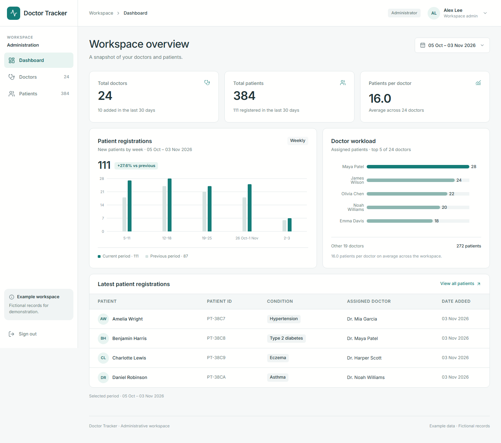

## Table of contents

- [Features](#features)
- [Screenshots](#screenshots)
- [Tech stack](#tech-stack)
- [Architecture](#architecture)
- [Repository layout](#repository-layout)
- [Getting started](#getting-started)
- [Environment variables](#environment-variables)
- [Demo login](#demo-login)
- [Scripts](#scripts)
- [Data model](#data-model)
- [API summary](#api-summary)
- [Technical decisions](#technical-decisions)
- [Assumptions and trade-offs](#assumptions-and-trade-offs)
- [Security notes](#security-notes)
- [Verification](#verification)
- [Version compatibility notes](#version-compatibility-notes)

## Features

- **Public home page** — `/` is a public landing page with the workspace value proposition, a product preview, and clear paths to registration and login. The public navbar contains Home and Login; Login becomes Dashboard when a session is active.
- **Public registration** — `/register` toggles between “Register as doctor” and “Register as patient.” A doctor supplies name, specialization, hospital, phone, email, a required profile photo, and a password. A patient supplies name, age, sex, condition, phone, required email, password, and selects an existing doctor. Both forms create `pending` requests for administrator review, not login accounts.
- **Authentication** — administrators, doctors, and patients sign in with the same Better Auth form. Public sign-up is disabled; accounts are created only by administrator approval or the seed command. Sign-out is available from every header and the admin sidebar. “Remember my email” stores only the email address in local storage.
- **Registration requests** — administrators review pending doctor and patient submissions at `/registration_request`, approve them into the matching directory and create the Better Auth account, or delete pending requests.
- **Doctor and patient portals** — approved doctors and patients reach `/portal`. A doctor can edit their own profile, replace their profile photo, search their assigned patients, open each patient's full read-only profile, and close care with **Treated** or **Reject** actions. Both actions release the patient to choose a new doctor; treated patients are retained in the doctor's history, while rejected patients disappear from the doctor's list and history. A patient can edit their own profile, choose the doctor assigned to their care, and see that doctor's full profile. Neither portal exposes another user's data or administrator CRUD, and sign-in emails stay administrator-managed.
- **Care history** — `/portal/history` is shared by both roles. Doctors see the patients they marked as treated, with the contact details captured at the time care ended. Patients see every past doctor with a neutral `Treatment completed` or `Care ended` label. History is stored as immutable snapshots in `patient_history`, so later profile edits do not rewrite past records.
- **Doctor directory** — create and edit doctors, search by name/email, filter by date added, specialization, and hospital, sort by name or date, and paginate. A doctor can be deleted only when no patients are assigned.
- **Doctor profiles** — doctor details, profile photo, contact information, derived reference, assigned patient total, and a scoped patient list with the same search/filter/sort/pagination controls. Doctors without a photo show initials until one is added.
- **Patient management** — register patients under a doctor, edit patient records, remove patients, and browse the full patient directory with condition, doctor, and date filters.
- **Dashboard** — total doctors, total patients, patients per doctor, new registrations for the selected range, grouped registration bars versus the previous period, doctor workload, and the latest patient registrations.
- **Responsive by design** — desktop tables, two-up tablet cards, mobile stacked cards, a tablet navigation drawer, a mobile header, and a fixed mobile bottom navigation bar.
- **Complete states** — designed loading skeletons, empty states, retryable error states, inline field errors, and toast confirmations.
- **Shareable list state** — search, filters, sort order, page number, and page size live in the URL, so browser back/forward and bookmarked views work.

## Screenshots

All screenshots in this repository are real captures of the running application at the stated viewport sizes. The demo data is fictional.

### Desktop — 1440 × 1000

| Dashboard                                    | Doctors directory                                  |
| -------------------------------------------- | -------------------------------------------------- |
|  | 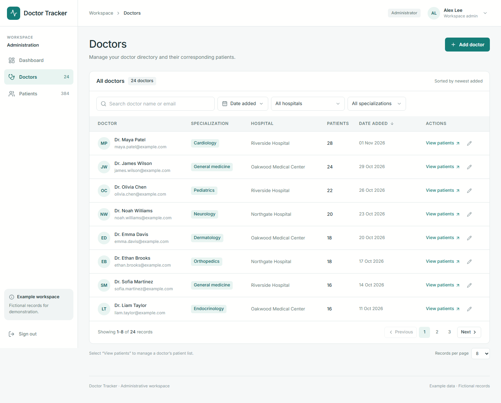 |

| Doctor profile and assigned patients                 | Patients directory                                   |
| ---------------------------------------------------- | ---------------------------------------------------- |
| 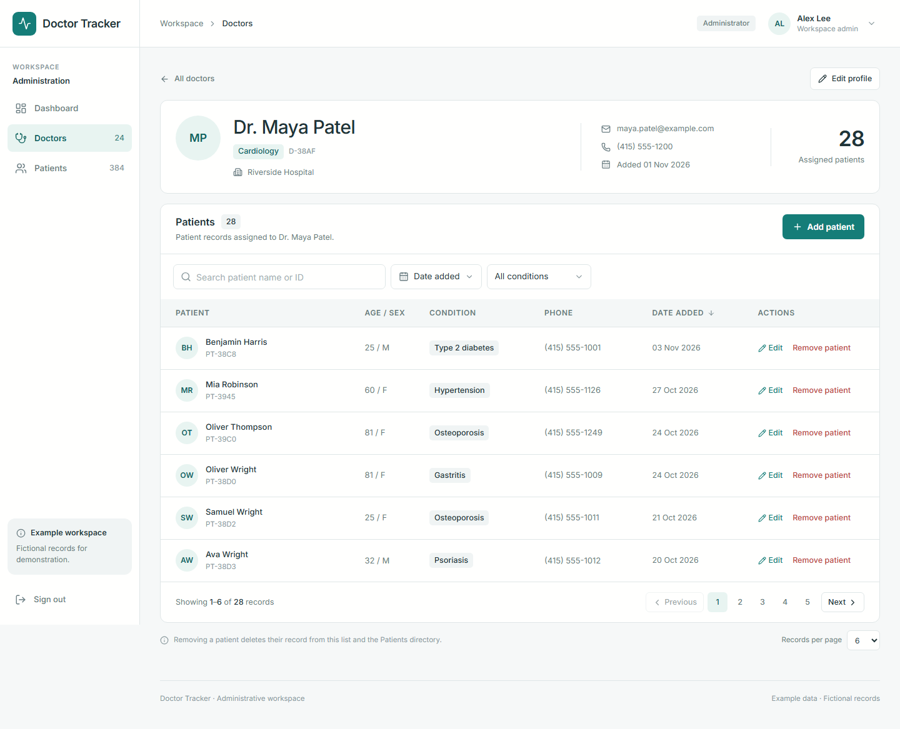 | 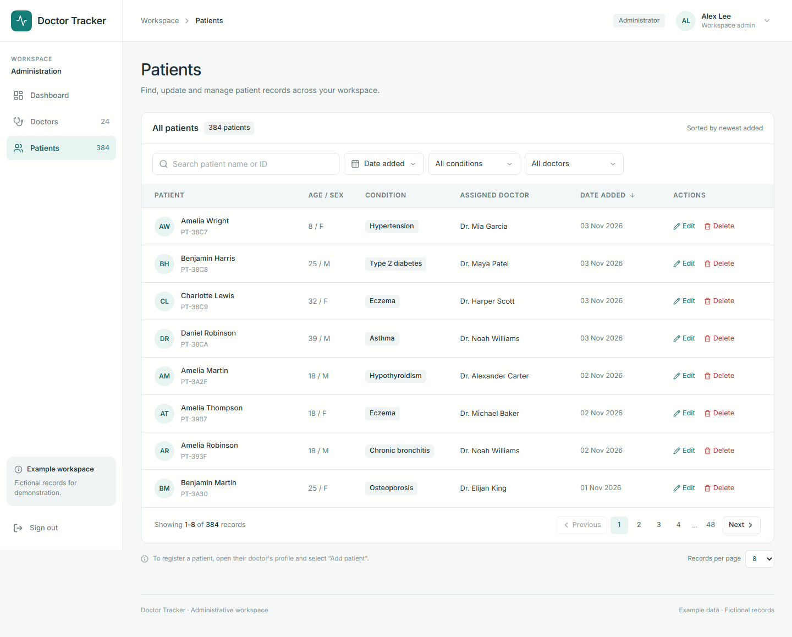 |

| Add doctor sheet                               | Add patient sheet                                |
| ---------------------------------------------- | ------------------------------------------------ |
| 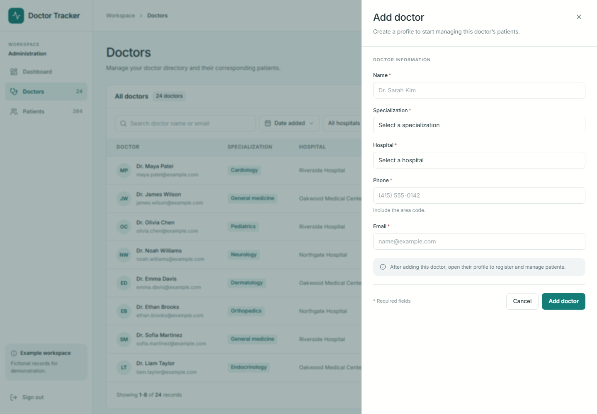 | 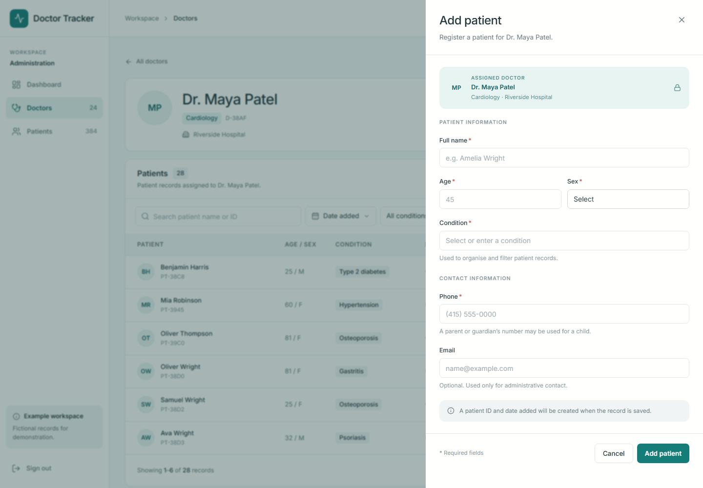 |

| Edit patient sheet                                 | Delete patient confirmation                            |
| -------------------------------------------------- | ------------------------------------------------------ |
| 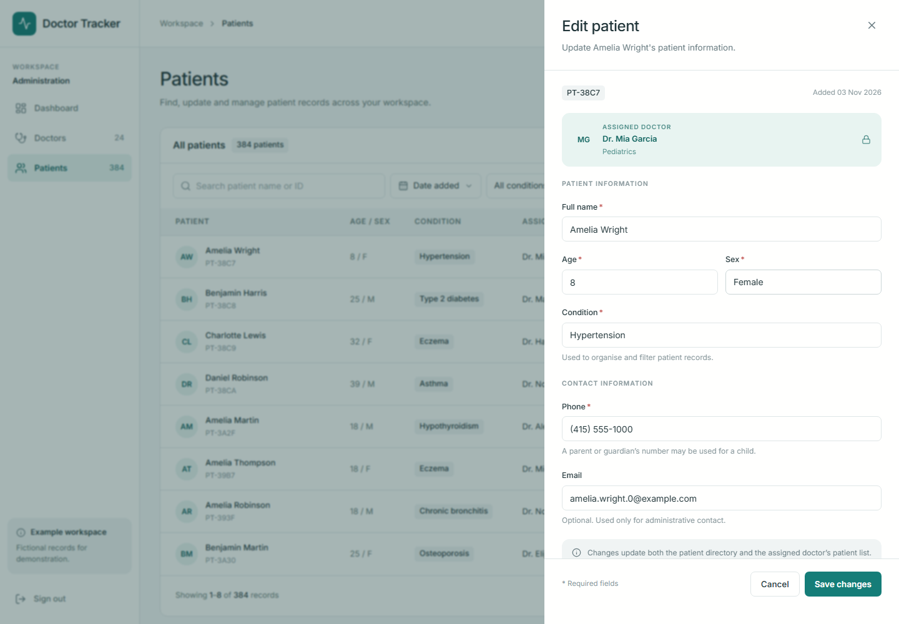 | 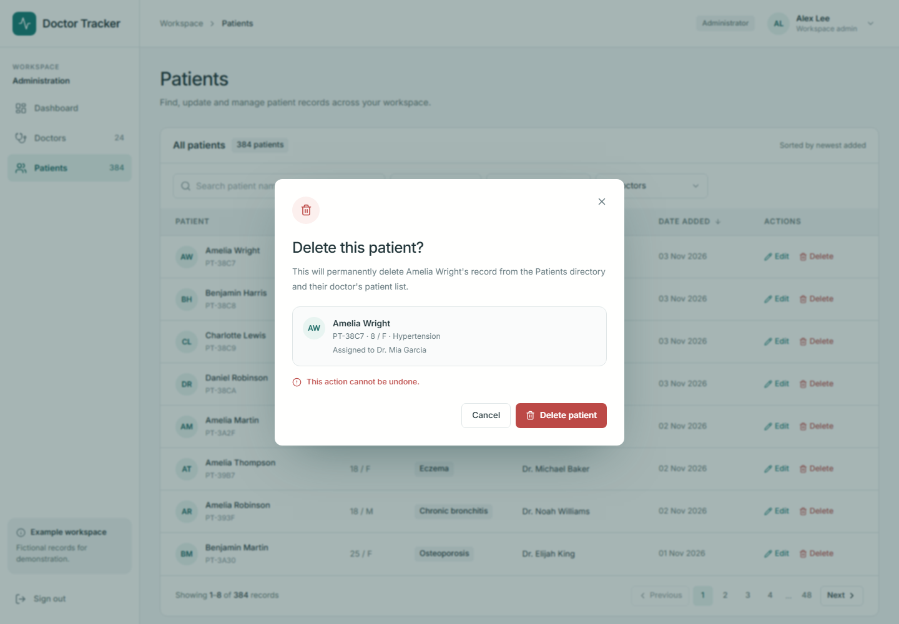 |

### Mobile — 390 × 844

| Dashboard                                                                              | Doctors                                                                            | Patients                                                                             |
| -------------------------------------------------------------------------------------- | ---------------------------------------------------------------------------------- | ------------------------------------------------------------------------------------ |
| 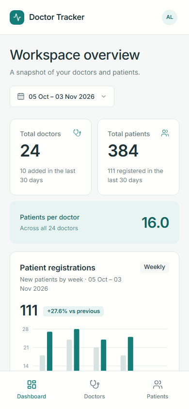 | 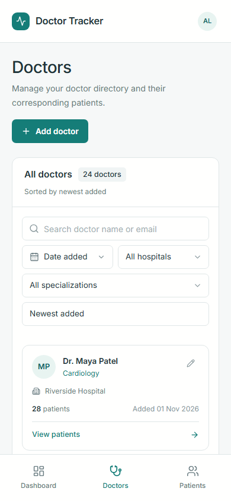 | 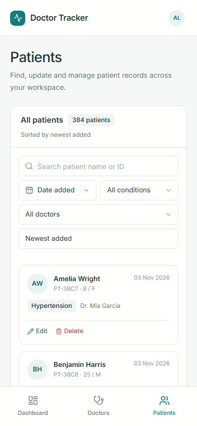 |

### Tablet — 768 × 1024

| Two-up doctor cards                                                                | Navigation drawer                                                                        |
| ---------------------------------------------------------------------------------- | ---------------------------------------------------------------------------------------- |
| 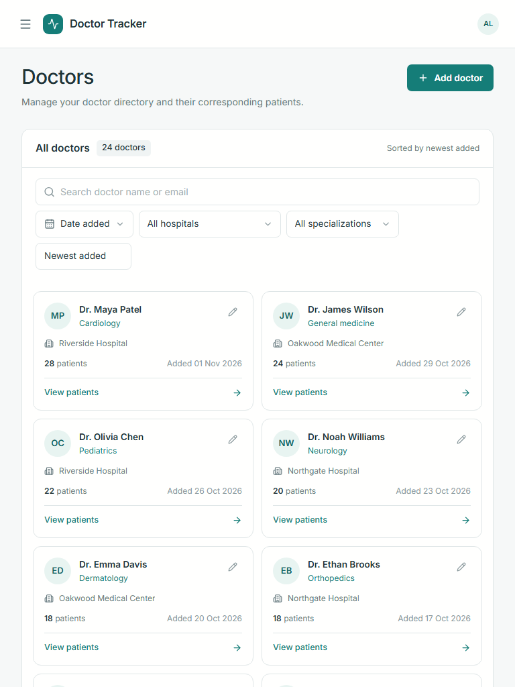 | 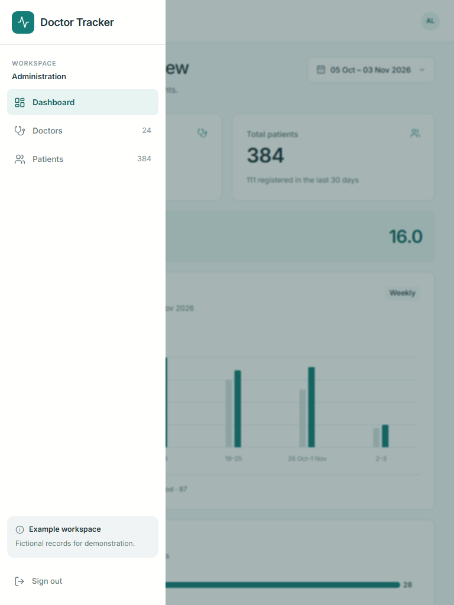 |

The login screen is the entry point to the admin workspace and the portal, neither of which can be reached without authentication:

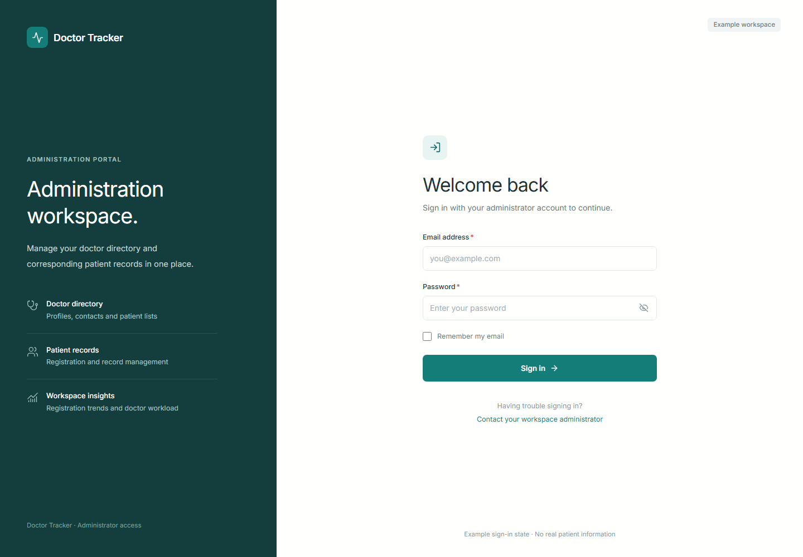

## Tech stack

| Layer          | Choice                                                     |
| -------------- | ---------------------------------------------------------- |
| Monorepo       | npm workspaces (`client`, `server`, `packages/*`)          |
| Frontend       | Next.js 16.4 App Router, React 19, JavaScript only         |
| Styling        | Tailwind CSS 4, daisyUI 5, custom design tokens            |
| Icons          | Lucide React                                               |
| Server state   | TanStack Query 5                                           |
| Forms          | React Hook Form + Zod                                      |
| Charts         | Recharts 3                                                 |
| Animation      | Motion (`motion/react`)                                    |
| Backend        | Express 5 on Node.js 22, ES modules, one `server/index.js` |
| Database       | MongoDB 8 with the native `mongodb` driver only            |
| Authentication | Better Auth 1.7 with the Better Auth MongoDB adapter       |
| Validation     | Shared Zod schemas in `packages/validation`                |
| Tooling        | ESLint 9, Prettier, npm workspaces, concurrently, nodemon  |

No TypeScript, ORM, or ODM is used. All source files are JavaScript. MongoDB access is through the native driver and aggregation pipelines.

## Architecture

```text
Browser
  │
  ├─ Next.js App Router pages
  │    ├─ /api/v1/* ──▶ Next.js rewrite ──▶ Express API ──▶ MongoDB
  │    │                  (same-origin,      (all business
  │    │                   first-party)       CRUD)
  │    │
  │    └─ /api/auth/* ──▶ Better Auth ──────▶ MongoDB
  │                       (the only Next.js
  │                        route handler)
  │
  ├─ Public pages (/, /register, /login)
  │    └─ no session required
  │
  ├─ Admin dashboard ── server-side admin-role check
  │                     + proxy.js optimistic redirect
  │
  └─ Doctor/patient portal ── server-side role check
                              + scoped portal API
```

### Request flow

1. The browser only calls same-origin paths. `client/next.config.mjs` rewrites `/api/v1/:path*` to the Express API defined by `API_URL`.
2. `client/proxy.js` performs an **optimistic** cookie redirect. It improves first-paint navigation but is never treated as authorization.
3. The admin route group (`client/app/(dashboard)/layout.js`) performs an authoritative `auth.api.getSession()` check on the server, redirects unauthenticated visitors to `/login`, sends doctors and patients to `/portal`, and hides workspace pages from every other role. The portal route group (`client/app/(portal)/layout.js`) applies the matching role check and sends administrators back to `/dashboard`.
4. Express applies `requireAuth` to every `/api/v1` route except the three public registration routes, forwarding request cookies to Better Auth and rejecting missing sessions with `401`. Portal routes resolve the directory record from the session user ID and require the matching role; doctors and patients may update only their own profile, doctors may record a treated/rejected outcome only for patients currently assigned to them, patients may also change their own assigned doctor, and every remaining route applies `requireAdmin`.
5. All writes are validated by shared Zod schemas before reaching `server/index.js`. MongoDB queries are built from validated, allow-listed values.
6. TanStack Query caches API responses on the client. Filters, sorting, and pagination are part of the query key because they are part of the URL.

Because authentication is hosted by Next.js on the same origin, the session cookie is first-party. The browser never talks to Express on a different origin, so no client-side CORS configuration or token handling is needed.

The Express API is intentionally implemented as a single `server/index.js` file. Routes, request handlers, MongoDB queries, dashboard aggregations, and the `seed`/`indexes` commands are colocated by design. Shared validation schemas (`packages/validation`) and the Better Auth configuration (`packages/auth`) stay in workspace packages because the Next.js client imports the same code.

### Why MongoDB must be a replica set

Better Auth uses MongoDB transactions for account and session operations. Transactions require a replica set or a sharded cluster, not a standalone `mongod`. MongoDB Atlas clusters are replica sets and work without changes. A local MongoDB installation must also run as a replica set; this project does not use Docker to provide one.

## Repository layout

```text
DoctorTracker/
├─ package.json                  # npm workspaces and root scripts
├─ .env.example                  # reference for every variable
├─ recuirements.txt              # functional specification
├─ .cursorrules                  # development rules
├─ project-plan.md               # approved implementation plan
├─ docs/screenshots/             # real UI screenshots
├─ client/
│  ├─ app/
│  │  ├─ (public)/               # public home and registration pages
│  │  ├─ (dashboard)/            # protected admin pages and session guard
│  │  ├─ (portal)/               # doctor/patient portal and role guard
│  │  ├─ api/auth/[...all]/      # Better Auth handler (only Next route handler)
│  │  ├─ login/
│  │  └─ globals.css             # Tailwind, daisyUI theme, design tokens
│  ├─ components/
│  │  ├─ layout/                 # app shell, portal shell, sidebar, navbars, footer
│  │  ├─ public/                 # registration form and success state
│  │  ├─ portal/                 # doctor/patient self-service portal views
│  │  ├─ ui/                     # sheets, dialogs, filters, pagination, skeletons
│  │  ├─ dashboard/
│  │  ├─ doctors/
│  │  └─ patients/
│  ├─ hooks/                     # TanStack Query and URL state hooks
│  ├─ lib/                       # API client, auth client, query keys, formatters
│  ├─ providers/                 # query, auth, toast, and motion providers
│  └─ proxy.js                   # optimistic auth redirect (Next.js 16 name)
├─ server/
│  ├─ index.js                   # single-file API, seed and index commands
│  └─ package.json
└─ packages/
   ├─ auth/                      # single Better Auth configuration
   └─ validation/                # shared Zod schemas and constants
```

## Getting started

### Prerequisites

- Node.js **22 or newer** (developed on Node 22.22)
- npm 10 or newer
- MongoDB Atlas, or an existing MongoDB 8 replica set (Docker is not used)

### 1. Install dependencies

```bash
npm install
```

### 2. Create the environment files

Copy the workspace-specific examples:

```bash
# macOS / Linux
cp client/.env.example client/.env
cp server/.env.example server/.env
```

```powershell
# Windows PowerShell
Copy-Item client/.env.example client/.env
Copy-Item server/.env.example server/.env
```

Generate a strong secret and use the **same value** in both files:

```bash
node -e "console.log(require('crypto').randomBytes(32).toString('base64'))"
```

Both Next.js and Express must share:

- `BETTER_AUTH_SECRET`
- `BETTER_AUTH_URL`
- `MONGODB_URI`
- `MONGODB_DB`

Environment values are trimmed at runtime, so accidental leading or trailing whitespace in the secret or URLs will not break authentication. The dev preflight still warns when whitespace is present so it can be cleaned up.

Replace the placeholder secret and seed password before running anything beyond a local demo. The default login below is intentionally a local-only credential.

### 3. Connect to MongoDB

This project does not use Docker. Use either:

- **MongoDB Atlas** (recommended), or
- an existing **MongoDB 8 replica set** that supports transactions.

Set `MONGODB_URI` and `MONGODB_DB` to the same values in **both** `client/.env` and `server/.env`.

For Atlas:

1. Set `MONGODB_URI` to your Atlas SRV connection string in both env files.
2. Set the same `MONGODB_DB` value in both files.
3. Run `npm run indexes` and `npm run seed`. A new Atlas database is empty, so seeding is required before the first login.
4. Start the app and check the API log. It prints the Atlas host and database name, never the credentials.

The cluster must support transactions, which Atlas replica sets and local replica sets do by default.

### 4. Create indexes and seed the demo workspace

```bash
npm run indexes
npm run seed
```

The seed script:

- creates the account configured by `SEED_ADMIN_EMAIL` through Better Auth with role `admin`, or leaves an existing account unchanged;
- **replaces** the `doctors` and `patients` collections with 24 doctors and 384 patients;
- uses dates relative to the seed run so dashboard ranges and charts are populated;
- prints the seeded administrator email.

All seeded records are fictional. Seeded doctors and patients are directory records only; they do not receive login accounts or portal access.

For an existing installation where the administrator account was created before roles were assigned, run `npm run promote-admin` once to grant the account configured by `SEED_ADMIN_EMAIL` the administrator role. This command updates only that exact existing Better Auth user; it does not rebuild doctors or patients. Sign out and sign back in afterward.

### 5. Run the applications

Run both workspaces together:

```bash
npm run dev
```

`npm run dev` runs `scripts/dev-preflight.mjs` first. The preflight verifies that both env files use the same secret (after trimming), MongoDB URI, database name, and auth URL, that `API_URL` matches the server `PORT`, and that ports **3000** and **4000** are free. It exits with a clear error if either port is occupied instead of letting Next.js quietly fall back to 3001.

Stop a production server (`npm run start -w client`) or another dev instance before starting. Do not run `next start` and `next dev` at the same time — both use the same ports.

Or run them in separate terminals:

```bash
npm run dev -w server   # nodemon index.js → http://127.0.0.1:4000
npm run dev -w client   # http://localhost:3000
```

The server dev command runs `nodemon index.js`, so backend edits restart the API automatically. Open [http://localhost:3000](http://localhost:3000). The API health check is available at [http://127.0.0.1:4000/health](http://127.0.0.1:4000/health). On startup the API logs the active MongoDB host and database name (for example `[db] Connected to cluster0….mongodb.net (database: doctor_tracker).`) without printing credentials.

The browser auth client uses the current origin, so authentication remains same-origin even if Next.js selects a different port. The documented and tested port is still 3000.

### Production build

```bash
npm run build
npm run start -w server
npm run start -w client
```

Stop the dev server before running the production client: `next start` and `next dev` both bind port 3000, and the API uses port 4000 for both modes.

For a real deployment, serve the client over HTTPS and set `BETTER_AUTH_URL` to that HTTPS origin. Secure cookies are enabled automatically when the auth URL uses HTTPS; the local HTTP setup does not use the `__Secure-` cookie prefix.

## Environment variables

| Variable              | Used by | Purpose                                                                        |
| --------------------- | ------- | ------------------------------------------------------------------------------ |
| `PORT`                | server  | Express port (default `4000`)                                                  |
| `MONGODB_URI`         | both    | MongoDB connection string; use `127.0.0.1` locally to avoid IPv6 issues        |
| `MONGODB_DB`          | both    | Database name (default `doctor_tracker`)                                       |
| `BETTER_AUTH_SECRET`  | both    | Session signing secret; must match in both apps                                |
| `BETTER_AUTH_URL`     | both    | Public client origin used by Better Auth (for example `http://localhost:3000`) |
| `CORS_ORIGINS`        | server  | Comma-separated allow-list for Express                                         |
| `NEXT_PUBLIC_APP_URL` | client  | Optional public app URL; auth uses the current browser origin                  |
| `API_URL`             | client  | Server-side rewrite target for the Express API                                 |
| `SEED_ADMIN_NAME`     | server  | Display name for the seeded administrator                                      |
| `SEED_ADMIN_EMAIL`    | server  | Login email for the seeded administrator                                       |
| `SEED_ADMIN_PASSWORD` | server  | Login password for the seeded administrator                                    |
| `IMGBB_API_KEY`       | server  | ImgBB key used to host doctor profile pictures; never expose it to the browser |

Never place `IMGBB_API_KEY`, `BETTER_AUTH_SECRET`, MongoDB credentials, or seed passwords behind a `NEXT_PUBLIC_` prefix.

## Demo login

The local seed defaults are:

```text
Email:    alex.lee@example.com
Password: ChangeMe123!
```

These values come from `server/.env`. Change them before using the project outside a local demo.

## Scripts

| Command                          | Description                                                              |
| -------------------------------- | ------------------------------------------------------------------------ |
| `npm run dev`                    | Run the dev preflight, then the Next.js client and Express API           |
| `npm run dev:client`             | Run only the Next.js client                                              |
| `npm run dev:server`             | Run only the Express API with nodemon                                    |
| `npm run build`                  | Production build of the client                                           |
| `npm run start -w client`        | Start the built Next.js client                                           |
| `npm run start -w server`        | Start the single-file Express API without watch mode                     |
| `npm run indexes`                | Run `node index.js indexes` to create/verify MongoDB indexes             |
| `npm run seed`                   | Run `node index.js seed` to rebuild demo data and provision the admin    |
| `npm run promote-admin`          | Promote only the existing `SEED_ADMIN_EMAIL` account; does not seed data |
| `npm run lint`                   | Run ESLint across the monorepo                                           |
| `npm run format`                 | Format with Prettier                                                     |
| `npm run format:check`           | Check formatting                                                         |
| `node scripts/dev-preflight.mjs` | Run the dev environment and port checks without starting the app         |

## Data model

Application collections use exactly the fields below. No extra sequence or display-ID fields are stored.

### `doctors`

| Field                    | Type     | Rules                                                   |
| ------------------------ | -------- | ------------------------------------------------------- |
| `_id`                    | ObjectId | Server-generated                                        |
| `name`                   | string   | Required, trimmed, 2–100 characters                     |
| `specialization`         | string   | Required, trimmed, 2–100 characters                     |
| `hospital`               | string   | Required, trimmed, 2–150 characters                     |
| `phone`                  | string   | Required, 7–20 characters                               |
| `email`                  | string   | Required, valid, lowercase, unique                      |
| `userId`                 | string   | Optional linked Better Auth user; unique when present   |
| `createdAt`              | Date     | Server-set                                              |
| `updatedAt`              | Date     | Server-set                                              |
| `registrationRequestId`  | ObjectId | Optional source registration ID for idempotency         |
| `profilePicture`         | object   | Optional ImgBB `url`, `thumbUrl`, and `mediumUrl`       |
| `patientMutationVersion` | number   | Internal transaction write lock; not exposed by the API |

### `patients`

| Field                   | Type     | Rules                                                                |
| ----------------------- | -------- | -------------------------------------------------------------------- |
| `_id`                   | ObjectId | Server-generated                                                     |
| `name`                  | string   | Required, trimmed, 2–100 characters                                  |
| `age`                   | number   | Required integer, 0–130                                              |
| `gender`                | string   | Required: `male`, `female`, or `other`                               |
| `condition`             | string   | Required, trimmed, 2–150 characters                                  |
| `phone`                 | string   | Required, 7–20 characters                                            |
| `email`                 | string   | Optional for admin-created records; required for public registration |
| `userId`                | string   | Optional linked Better Auth user; unique when present                |
| `doctorId`              | ObjectId | Optional reference to `doctors._id`; cleared when care ends          |
| `createdAt`             | Date     | Server-set                                                           |
| `updatedAt`             | Date     | Server-set                                                           |
| `registrationRequestId` | ObjectId | Optional source registration ID for idempotency                      |

### `patient_history`

Appended when a doctor marks an assigned patient as `treated` or `rejected`. The patient record is released in the same transaction (`doctorId` removed), and the history entry keeps immutable snapshots of both sides so later profile edits do not change past records.

| Field       | Type     | Rules                                                       |
| ----------- | -------- | ----------------------------------------------------------- |
| `_id`       | ObjectId | Server-generated                                            |
| `patientId` | ObjectId | Reference to the patient record                             |
| `doctorId`  | ObjectId | Reference to the doctor who ended care                      |
| `patient`   | object   | `{ reference, name, age, gender, condition, phone, email }` |
| `doctor`    | object   | `{ name, specialization, hospital, phone, email }`          |
| `outcome`   | string   | `treated` or `rejected`                                     |
| `endedAt`   | Date     | Server-set time the relationship ended                      |

A doctor's history endpoint returns only `treated` entries. A patient's history endpoint returns both outcomes, labelled `Treatment completed` and `Care ended` in the UI. Deleting a patient also deletes that patient's history entries; deleting a doctor is still refused while patients reference them, and existing history snapshots keep the doctor's captured details.

### `registration_requests`

Public registrations are stored separately from the live directory. Each document has `type` (`doctor` or `patient`), request `role` (`doctor` or `patient`), `status: "pending"`, and server-set `createdAt`/`updatedAt` timestamps. A request remains pending until approved or deleted; successful approval removes it in the same transaction that inserts the live directory record.

Doctor requests add:

| Field                | Type   | Rules                                                               |
| -------------------- | ------ | ------------------------------------------------------------------- |
| `name`               | string | Required, trimmed, 2–100 characters                                 |
| `specialization`     | string | Required, trimmed, 2–100 characters                                 |
| `hospital`           | string | Required, trimmed, 2–150 characters                                 |
| `phone`              | string | Required, 7–20 characters                                           |
| `email`              | string | Required, valid, lowercase and unique among pending doctor requests |
| `profilePicture`     | object | Required ImgBB `url`, `thumbUrl`, and `mediumUrl`                   |
| `passwordCredential` | object | AES-256-GCM encrypted password with IV, tag, and algorithm version  |

Patient requests add:

| Field                | Type     | Rules                                                                |
| -------------------- | -------- | -------------------------------------------------------------------- |
| `name`               | string   | Required, trimmed, 2–100 characters                                  |
| `age`                | number   | Required integer, 0–130                                              |
| `gender`             | string   | Required: `male`, `female`, or `other`                               |
| `condition`          | string   | Required, trimmed, 2–150 characters                                  |
| `phone`              | string   | Required, 7–20 characters                                            |
| `email`              | string   | Required for new public requests, valid email                        |
| `passwordCredential` | object   | AES-256-GCM encrypted password with IV, tag, and algorithm version   |
| `doctorId`           | ObjectId | Required reference to an existing `doctors._id`                      |
| `doctorSnapshot`     | object   | Captured doctor name, specialization and hospital at submission time |

A patient request is rejected with `404` when the selected doctor does not exist. A doctor request is rejected with `409` when the email belongs to an existing doctor or another pending doctor request. Public submissions do not create Better Auth users, sessions, or live `doctors`/`patients` records. The password is encrypted with a key derived from `BETTER_AUTH_SECRET` and is decrypted only while an administrator approves the request. Administrators approve requests in the dashboard; approval creates the Better Auth account, transactionally inserts the matching directory record with its `userId`, and removes the pending request. If the transaction fails, the new auth account is removed again on a best-effort basis. The created record stores the source request ID for idempotency. Legacy pending requests without encrypted credentials still approve as directory records but do not create an account. Deleting a pending request removes only that request and never deletes an active record with a matching email. Deleting an active patient or doctor uses the directory controls and best-effort removes the linked Better Auth account; doctor deletion is refused while patients or pending patient requests reference it.

Doctor self-registration requires a profile picture. The API validates the image and uploads it to ImgBB from the server, stores only the public image URLs, and copies them onto the doctor record during approval. The ImgBB key stays in `server/.env`. Doctors can replace their photo from the portal; existing and admin-created doctors without a photo show initials until the doctor adds one. The admin Add/Edit doctor form does not manage photos.

Better Auth owns its `user`, `session`, `account`, and `verification` collections. The separate `promote-admin` command narrowly updates the configured existing user's role in the Better Auth `user` collection; do not use `npm run seed` for role promotion because it replaces doctors and patients.

### Display references

The UI shows `D-XXXX` for doctors and `PT-XXXX` for patients. These references are derived at serialization time from the last four hexadecimal characters of the ObjectId; they are not sequential identifiers and are not stored in MongoDB. Patient reference search (for example `PT-38C7`) is supported by matching the ObjectId suffix.

### Indexes

- Doctors: unique `email`; unique sparse `userId`; `createdAt`; `(specialization, createdAt)`; `(hospital, createdAt)`; text index on `name`, `specialization`, `hospital`, and `email`.
- Patients: unique sparse `userId`; `(doctorId, createdAt)`; `(condition, createdAt)`; `createdAt`; text index on `name` and `condition`.
- Patient history: `(patientId, endedAt)`; `(doctorId, outcome, endedAt)`.
- Doctors and patients: unique sparse `registrationRequestId` links prevent one request from creating multiple directory records.
- Registration requests: `(type, status, createdAt)`; `doctorId`; unique partial index on `email` where `type` is `doctor` and `status` is `pending`.

Indexes are idempotent and created at API startup; `npm run indexes` runs the same logic explicitly.

## API summary

Base path: `/api/v1`. Every route except `GET /health` and the three `/api/v1/public/*` routes requires a Better Auth session. Portal routes require the matching `doctor` or `patient` role; every other protected route requires `admin`. The browser reaches the API through the Next.js rewrite.

| Method   | Path                                                           | Purpose                                                                                          |
| -------- | -------------------------------------------------------------- | ------------------------------------------------------------------------------------------------ |
| `GET`    | `/health`                                                      | Unauthenticated health check                                                                     |
| `GET`    | `/api/v1/public/doctors/options`                               | Public read-only doctor options for the patient registration form                                |
| `POST`   | `/api/v1/public/registrations/doctors`                         | Create a pending doctor registration request                                                     |
| `POST`   | `/api/v1/public/registrations/patients`                        | Create a pending patient registration request                                                    |
| `GET`    | `/api/v1/portal/doctor`                                        | Doctor's own profile and assigned patient count (doctor role)                                    |
| `PATCH`  | `/api/v1/portal/doctor`                                        | Update the signed-in doctor's name, specialization, hospital, and phone (doctor role)            |
| `GET`    | `/api/v1/portal/doctor/patients`                               | Paginated patients assigned to the signed-in doctor (doctor role)                                |
| `POST`   | `/api/v1/portal/doctor/patients/:id/treatment`                 | Mark an assigned patient `treated` or `rejected`, release them, and record history (doctor role) |
| `GET`    | `/api/v1/portal/doctor/history`                                | Paginated treated-patient history snapshots (doctor role)                                        |
| `GET`    | `/api/v1/portal/patient`                                       | Own record plus the assigned doctor's contact details (patient role)                             |
| `PATCH`  | `/api/v1/portal/patient`                                       | Update the signed-in patient's name, age, sex, condition, and phone (patient role)               |
| `PATCH`  | `/api/v1/portal/patient/doctor`                                | Change the signed-in patient's assigned doctor (patient role)                                    |
| `GET`    | `/api/v1/portal/patient/history`                               | Paginated past-doctor history snapshots, treated and rejected (patient role)                     |
| `GET`    | `/api/v1/doctors`                                              | Paginated doctor list with search, date, specialization, hospital, sort                          |
| `POST`   | `/api/v1/doctors`                                              | Create a doctor                                                                                  |
| `GET`    | `/api/v1/doctors/options`                                      | Lightweight doctor options for selects                                                           |
| `GET`    | `/api/v1/doctors/:id`                                          | Doctor detail with assigned patient count                                                        |
| `PATCH`  | `/api/v1/doctors/:id`                                          | Update a doctor                                                                                  |
| `DELETE` | `/api/v1/doctors/:id`                                          | Delete doctor only when no patients reference it                                                 |
| `GET`    | `/api/v1/doctors/:id/patients`                                 | Paginated patients scoped to a doctor                                                            |
| `GET`    | `/api/v1/patients`                                             | Paginated patient directory with search, date, condition, doctor filters                         |
| `POST`   | `/api/v1/patients`                                             | Create a patient under a doctor                                                                  |
| `GET`    | `/api/v1/patients/:id`                                         | Patient detail                                                                                   |
| `PATCH`  | `/api/v1/patients/:id`                                         | Update a patient                                                                                 |
| `DELETE` | `/api/v1/patients/:id`                                         | Delete a patient                                                                                 |
| `GET`    | `/api/v1/registration-requests?page=1&limit=20`                | Paginated pending list and total count                                                           |
| `POST`   | `/api/v1/registration-requests/:id/approve`                    | Create the account when credentials exist, insert the directory record, and remove the request   |
| `DELETE` | `/api/v1/registration-requests/:id`                            | Hard-delete a pending request                                                                    |
| `GET`    | `/api/v1/dashboard/summary?range=7d\|30d\|90d\|12m`            | Totals, averages, and range comparisons                                                          |
| `GET`    | `/api/v1/dashboard/patients-per-doctor`                        | Doctor workload, top 10                                                                          |
| `GET`    | `/api/v1/dashboard/patients-over-time?range=7d\|30d\|90d\|12m` | Current and previous period buckets                                                              |

Doctor list query parameters: `page`, `limit`, `search`, `specialization`, `hospital`, `from`, `to`, `sort`, `order`.

Patient list query parameters: `page`, `limit`, `search`, `condition`, `doctorId`, `from`, `to`, `sort`, `order`.

History query parameters: `page`, `limit`, `search`, `from`, `to`, `sort`, `order`. `from`/`to` filter `endedAt`; `sort` accepts `createdAt` (mapped to `endedAt`) and `name` (mapped to the patient or doctor snapshot name).

Responses use a consistent envelope:

```json
{
  "success": true,
  "data": {},
  "meta": {}
}
```

```json
{
  "success": false,
  "error": {
    "code": "VALIDATION_ERROR",
    "message": "Please check the submitted values and try again.",
    "details": {}
  }
}
```

Error codes: `VALIDATION_ERROR`, `UNAUTHORIZED`, `FORBIDDEN`, `NOT_FOUND`, `CONFLICT`, `RATE_LIMITED`, `SERVICE_UNAVAILABLE`, `INTERNAL_ERROR`. Status codes follow the usual conventions: `200` read/update, `201` create, `204` delete, `400` validation, `401` unauthenticated, `403` role mismatch, `404` missing, `409` duplicate/conflicting record, `429` rate limited, `500` unexpected, `503` transaction support unavailable.

Notes:

- Public registration writes are rate limited to 10 requests per 10 minutes per IP, in addition to the general read limiter.
- Public registration responses contain only the new request ID and `pending` status. Passwords are never returned.
- New public doctor and patient requests require a password of 8–128 characters; public patient email is required because it becomes the login email.
- Doctor email is unique; a duplicate returns `409` with the field error.
- `PATCH /api/v1/portal/doctor` accepts only `name`, `specialization`, `hospital`, and `phone`. The sign-in email stays administrator-managed.
- `PATCH /api/v1/portal/patient` accepts only `name`, `age`, `gender`, `condition`, and `phone`. The sign-in email stays administrator-managed.
- `PATCH /api/v1/portal/patient/doctor` accepts only `doctorId`, verifies that the doctor exists, and moves the signed-in patient's record transactionally. The response is the same enriched portal record returned by `GET /api/v1/portal/patient`.
- `POST /api/v1/portal/doctor/patients/:id/treatment` accepts only `outcome: "treated" | "rejected"`. It resolves the doctor from the session, requires the patient to be currently assigned to that doctor (`404` otherwise), appends an immutable `patient_history` snapshot, clears the patient's `doctorId`, and returns the new history entry in the same transaction. The patient can then choose another doctor; the rejecting doctor is not blocked from being chosen again.
- Doctor history returns only `outcome: "treated"` entries. Patient history returns both outcomes. Both endpoints resolve the doctor or patient from `req.user.id` and never accept a portal record ID from the client.
- `GET /api/v1/portal/patient` includes the signed-in patient's own record and the assigned doctor's name, specialization, hospital, phone, and email. Doctor summaries in the directory and doctor-facing patient lists remain limited to name and specialization.
- Deleting a doctor with assigned patients returns `409`; reassign or delete those patients first.
- Deleting a doctor with assigned patients or pending patient requests returns `409`; resolve those references first.
- Legacy active records may still contain a registration request link; deleting such a record removes that linked request if it exists.
- Approval creates the Better Auth account first, then runs the MongoDB transaction. If the transaction fails, the account is removed again on a best-effort basis; a failed cleanup can leave an orphan account that blocks a retry with the same email.
- Registration approval uses MongoDB transactions and requires a replica set (Atlas is supported).
- `from` and `to` filter `createdAt` using inclusive UTC day boundaries.
- Sorting is limited to `createdAt` and `name`; `order` is `asc` or `desc`.
- Pagination always adds `_id` as a stable final sort key.
- Write requests require JSON content type and are limited to 1 MB.

## Technical decisions

### 1. Native MongoDB driver with aggregation-first queries instead of an ODM

**Decision:** use the official `mongodb` driver directly, with aggregation pipelines for lists and dashboard read models. No Mongoose, Prisma, or other ODM.

**Why:**

- The doctor list needs a patient count per doctor. Rather than issuing one count query per row (N+1), the API pages the doctors first and performs a single `$lookup` plus `$size` for those IDs. Doctors with no patients remain in the result with a count of `0`.
- The patient list needs a small doctor summary on every row. A single `$lookup` projects only `{ name, specialization }` for directory and doctor-facing lists. The patient portal uses a separate lookup that adds `hospital`, `phone`, and `email` only for the signed-in patient's own assigned doctor.
- Doctor workload is one aggregation: group patients by `doctorId`, look up the doctor, sort descending, and limit to the top 10.
- A shared `MongoClient` is owned by `packages/auth` and reused directly by `server/index.js`, avoiding duplicate pools in development hot reloads.
- There is no hidden query layer. Query shape, indexes, projections, and sort tie-breakers are visible in the same file and can be reasoned about directly.

**Trade-offs:** there is no ODM schema enforcement or automatic hydration. Validation is handled by shared Zod schemas at the API boundary, and explicit serializers shape every response. This is more code than a one-line `populate`, but the resulting queries are predictable and the API contract stays decoupled from raw documents.

### 2. URL state plus TanStack Query instead of a global client store

**Decision:** keep list state in the URL, and keep server data in TanStack Query. Do not mirror lists, filters, or pagination in a global client store.

**Why:**

- Search, filters, sort, page, and page size are shareable and bookmarkable. Reloading the page restores the exact view.
- Browser back and forward work without custom synchronization code.
- Query keys are derived from the same URL state, so changing a filter naturally requests and caches the right resource. Returning to a previous filter combination can reuse cached data while TanStack Query revalidates in the background.
- The URL is the single source of truth for “which records am I looking at”; there is no risk of a Redux/Zustand slice and the address bar disagreeing.
- The pattern is consistent across the doctor directory, doctor-scoped patients, and the patient directory.

**Trade-offs:** the URL becomes a small state machine, so defaults, validation, and unknown values must be handled carefully. This project centralizes that logic in `use-url-list-state.js`, including allow-listed page sizes and sort fields. Mutations still invalidate the relevant query keys, so lists update without manual cache surgery.

## Assumptions and trade-offs

- **Age instead of date of birth.** The Figma uses “Date of birth”, but the functional specification requires a numeric `age` field and no date-of-birth field. The form and tables use age, matching the approved plan.
- **Derived references.** Figma shows sequential IDs such as `PT-0384` and `D-024`. The specification defines no ID fields, so references are derived from the ObjectId suffix. They are display references, not sequential IDs; a four-hex suffix can theoretically collide across a very large dataset.
- **Three KPI cards.** The Figma’s three-card layout is preserved, with new-patient counts shown in the registrations summary rather than a fourth card.
- **Chart types follow Figma.** Patient registrations use grouped bars comparing the current and previous periods. Doctor workload uses horizontal bars.
- **Extra edit actions.** Doctor edit and patient edit are included even though the Figma omits them, because the functional specification requires patient editing and doctor updates.
- **Guarded doctor deletion.** An administrator may delete a doctor only after assigned patients have been reassigned/deleted and pending patient requests have been resolved. The API checks this rule transactionally and never cascades patient deletion.
- **Public registration is request-only until approval.** The public site stores doctor and patient submissions in `registration_requests` with `status: "pending"` and an AES-256-GCM encrypted password. An administrator approves requests through `/registration_request`; approval creates a Better Auth account with the stored password, transactionally inserts the directory record with its `userId`, and removes the request. Better Auth public sign-up is disabled, so `auth.api.createUser` is the only account-creation path used by approval and seeding. Legacy pending requests without encrypted credentials approve as directory records without accounts. Deleting a pending request never deletes a directory record.
- **Admin role setup is explicit.** Seeding creates the administrator through `auth.api.createUser` with role `admin`. For an existing installation, run `npm run promote-admin` once to promote the existing account configured by `SEED_ADMIN_EMAIL`; this command does not touch directory data. The administrator must sign out and back in after promotion.
- **Three roles, one login.** Better Auth roles are `admin`, `doctor`, and `patient`. Administrators keep the full workspace. Doctors can read and update only their own profile, read the patients assigned to them, open those patients' full profiles in the portal, and mark an assigned patient as treated or rejected. Patients can update their own profile, change their assigned doctor, read only their own record, see the profile of their current doctor, and review their own past doctors. Neither role can call the admin CRUD routes, even by guessing a URL.
- **Care ends with an immutable history entry.** Marking a patient treated or rejecting them both clear the patient's `doctorId`, so the patient can choose a new doctor from their portal. The difference is visibility: treated entries appear in the doctor's treatment history, while rejected entries are visible only to the patient (as `Care ended`) and the administrator. The snapshots in `patient_history` are copied at the moment care ends, so later profile or doctor edits do not rewrite the record. There is no doctor blocklist; a rejected patient may choose the same doctor again. Patients may not end care unilaterally from their portal.
- **Account lifecycle is intentionally narrow.** There is no password reset, password change, or account email-change flow. Doctors and patients can edit their profile fields from the portal, but their sign-in email stays administrator-managed. The email on a directory record is captured when the account is created; later administrator edits to that email do not update the Better Auth login email. Seeded and administrator-created directory rows have no login account, so they cannot use the portal unless a linked account is provisioned separately. Legacy pending requests without an encrypted password approve without an account. Deleting a linked directory record removes the account on a best-effort basis; if that cleanup fails, an orphan account can remain. Changing `BETTER_AUTH_SECRET` makes existing pending password credentials unreadable, so those applicants must submit a new registration.
- **Public doctor options are intentionally narrow.** The patient form needs a doctor list before login, so `GET /api/v1/public/doctors/options` exposes only doctor ID, name, specialization, and hospital. It never returns contact details or patient data.
- **UTC buckets.** Date filters and dashboard day/week/month buckets use UTC. This keeps server results deterministic; it means a user in a distant timezone may see a registration near midnight in a different local bucket.
- **Seed data is intentionally replaceable.** Running `npm run seed` clears and recreates doctors and patients. It does not delete the existing administrator account.
- **MongoDB must be a replica set.** Better Auth uses transactions. Atlas and locally configured replica sets work; a standalone `mongod` will fail transaction-dependent auth operations. No Docker setup is included.
- **Local HTTP cookies.** Secure cookies are enabled only when `BETTER_AUTH_URL` starts with `https://`. This allows `next start` over `http://localhost` to work while keeping secure cookies in an HTTPS deployment.
- **Rate limits are per process.** The API allows 240 reads per minute and 60 writes per minute per client, and public registration writes are limited to 10 requests per 10 minutes per IP. In a multi-instance deployment, replace the default in-memory store with a shared store if global limits are required.
- **No committed end-to-end suite.** Verification was performed with temporary API and Playwright smoke scripts during development. The app itself, seed data, and screenshots are real; no test results are fabricated.

## Security notes

- The admin and portal layouts perform authoritative server-side role checks; `proxy.js` is only an optimistic redirect.
- Express revalidates the uncached session on every `/api/v1` request. Only the three explicitly public routes are registered before `requireAuth`; portal routes then require the matching `doctor` or `patient` role, and every remaining protected route requires `admin`.
- Portal routes resolve the doctor or patient record from `req.user.id` and never accept a directory record ID from the client. Doctors may update only their own profile through a strict allow-list, read only patients assigned to them, and end care only for patients currently assigned to them. Patients may update their own profile and change their own assigned doctor through a `doctorId`-only endpoint that verifies the target doctor. The patient portal response includes only the signed-in patient's record and their assigned doctor's contact fields. History endpoints return only the signed-in user's own entries. One portal user cannot read or change another user's data.
- Pending registration passwords are encrypted with AES-256-GCM using an HKDF-derived key from `BETTER_AUTH_SECRET` and an AAD bound to the request type and normalized email. The ciphertext is never returned by an API serializer and is decrypted only during administrator approval.
- Better Auth public sign-up is disabled. Accounts are created through `auth.api.createUser` during approval or seeding, never by public HTTP registration.
- `npm run promote-admin` updates exactly one user matching `SEED_ADMIN_EMAIL`, fails closed for zero/multiple matches, and is separate from the destructive seed command.
- Public registration writes are limited to 10 requests per 10 minutes per IP and return only the request ID and status.
- The public doctor options endpoint exposes only the fields needed by the patient registration form (ID, name, specialization, hospital).
- Request bodies are strict Zod objects; unknown fields are rejected. ObjectIds and query parameters are validated before database code runs.
- MongoDB filters are constructed from allow-listed fields. Free-text search uses MongoDB text indexes; the only regular-expression lookup is the four-hex reference suffix derived from a validated ObjectId.
- Helmet sets security headers, CORS uses an explicit allow-list with credentials enabled, and the JSON body limit is 1 MB.
- Login responses use a generic message for invalid credentials. Stack traces, raw database errors, and password material are never returned.
- Session cookies are HttpOnly and SameSite=Lax. Secure cookies are used when the configured auth origin is HTTPS.
- `BETTER_AUTH_SECRET`, `IMGBB_API_KEY`, MongoDB credentials, and seed passwords stay server-side. The only browser-exposed variable is the optional `NEXT_PUBLIC_APP_URL`, which is informational; auth requests use the current origin.
- Doctor photos are uploaded through the API. The server validates the image type and size before forwarding it to ImgBB, stores only public URLs, and never returns the ImgBB API key. The JSON body limit remains 1 MB; the client crops and resizes photos to a 512×512 JPEG before submission.

## Verification

The implemented workspace was verified with:

- `npm run lint` — passes.
- `npm run format:check` — passes.
- `npm run build` — production build passes.
- `npm run indexes` and `npm run seed` — complete successfully against MongoDB 8 and MongoDB Atlas. The Atlas workspace was seeded with 24 doctors, 384 patients, and one administrator.
- `npm run dev` — the preflight passes, Next.js serves on `http://localhost:3000`, and the API health check returns `200`. The API startup log identifies the Atlas host and database without credentials.
- After the single-file backend refactor, `npm run lint`, `npm run format:check`, `npm run build`, `npm run indexes`, and `npm run dev` were re-run successfully. Nodemon starts `server/index.js`, the health check returns `200`, and unauthenticated `/api/v1/doctors` returns `401`.
- A temporary API smoke script — 26/26 checks passed, covering authentication, doctor and patient CRUD, duplicate-email `409`, validation `400`, missing-resource `404`, unauthorized `401`, reference search, filters, dashboard ranges, and guarded doctor deletion.
- A temporary Playwright script — 12/12 UI checks passed, covering login, doctor creation and editing, patient creation/editing/deletion from a doctor profile, directory search and filters, reference search, and mobile/tablet navigation.
- A second temporary Playwright pass — 8/8 checks passed, covering unauthenticated redirects, URL filter persistence through refresh, empty-form validation, sign-out, and session clearing.
- A responsive overflow pass at 1440, 1280, 1024, 768, 390, and 375 pixels — 24/24 checks passed across the dashboard, doctors, doctor detail, and patients pages.
- A dashboard consistency pass — 3/3 checks passed, confirming the total patient count changes from 384 to 385 after a create and back to 384 after the matching delete.
- A dashboard chart-render pass — 4/4 checks passed, confirming both Recharts surfaces mount with visible bar geometry on the default and 90-day ranges, with no browser console errors.
- A public-site API pass — anonymous doctor options returned `200` with 24 doctors; doctor registration returned `201`; a duplicate doctor request returned `409` with an email field error; patient registration returned `201`; an unknown doctor returned `404`; unauthenticated `/api/v1/doctors` remained `401`.
- A public-site browser pass — verified the home page and navbar at 1440, 390, and 375 pixels, the Home/Login links, the patient/doctor tab toggle, 25 doctor options in the patient select, five inline validation errors on an empty doctor submit, successful doctor registration with the pending-review success panel, and the Dashboard link replacing Login when signed in. The patient form was also submitted end-to-end at 375 pixels with the success panel, no console errors, and zero horizontal overflow.
- After the public-site addition, `npm run lint`, `npm run format:check`, and `npm run build` were re-run successfully; the production build lists `/` as a static route and `/register` as dynamic.
- After the approval-account and portal changes, `npm run lint`, `npm run format:check`, and `npm run build` were re-run successfully; the production build lists `/portal` as a dynamic route. `npm run indexes` verified the new `userId` indexes against MongoDB.
- A temporary API smoke pass — 55/55 checks passed against a disposable database. It covered public doctor and patient registration with passwords, encrypted-credential and `userId` non-disclosure, administrator approval creating accounts, doctor/patient sign-in, own-record portal reads, cross-role `403` responses, admin doctor and patient CRUD regressions, guarded doctor deletion, and linked-account removal after record deletion. The disposable database was dropped afterward.
- After the doctor self-service profile change, `npm run lint`, `npm run format:check`, and `npm run build` pass. A temporary API smoke pass — 22/22 checks passed against a disposable database, covering doctor registration and approval, doctor sign-in, own-profile `GET`/`PATCH`, persisted updates, Better Auth display-name sync, hidden `userId`/password fields, rejection of email and `userId` injection, non-JSON and empty-body rejection, cross-role `403` responses, the doctor patient list, and admin doctor create/delete regressions. The disposable database was dropped afterward.
- After the portal profile-viewing change, `npm run lint`, `npm run format:check`, and `npm run build` pass. A temporary API smoke pass — 35/35 checks passed against a disposable database, covering doctor-scoped patient lists, forged `doctorId` rejection, full patient records in the doctor portal, the enriched assigned-doctor profile in the patient portal, internal-field non-disclosure, cross-role `403` responses, doctor self-profile updates, and admin patient/doctor regressions. The disposable database was dropped afterward.
- After the patient self-service change, `npm run lint`, `npm run format:check`, and `npm run build` pass. A temporary API smoke pass — 55/55 checks passed against a disposable database, covering patient registration and approval, patient sign-in, own-profile `PATCH` with a strict allow-list, Better Auth display-name sync, rejection of email/`userId`/`doctorId` injection and invalid fields, transactionally verified doctor reassignment, updated doctor-scoped patient lists and counts, cross-role `403` responses, doctor self-profile regressions, and admin doctor/patient CRUD regressions. The disposable database was dropped afterward.
- After the care-history change, `npm run lint`, `npm run format:check`, and `npm run build` pass; the production build lists `/portal/history` as a dynamic route. A temporary API smoke pass — 41/41 checks passed against a disposable database, covering treated and rejected outcomes, released patients, reassignment (including back to the rejecting doctor), doctor history restricted to `treated`, patient history with both outcomes, history search/date filters and inverted-range `400`s, immutable snapshots after later profile edits, cascading history deletion, hidden internal IDs, cross-role `403` responses, and admin CRUD/dashboard regressions. The disposable database was dropped afterward.
- A temporary Playwright pass against that database — 10/10 checks passed, covering the doctor's **Treated** and **Reject** success toasts and row removal, the rejection confirmation dialog, doctor and patient history screens with `Treatment completed` / `Care ended` labels, the released patient's portal, and the admin's unassigned-patient edit banner and save. A follow-up admin pass — 4/4 checks passed, confirming the `Patient updated` toast and that the edited condition is reflected in the directory.
- After the doctor profile-picture change, `npm run lint`, `npm run format:check`, and `npm run build` pass. A temporary API smoke pass — 18/18 checks passed against a disposable database with real ImgBB uploads, covering required registration photos, the server-side upload and URL storage, approval copying the photo, portal replacement, directory and patient serialization, invalid-image rejection, admin photo-field rejection, and ImgBB key non-disclosure. The disposable database was dropped afterward.
- A temporary Playwright pass against that database — registration with a cropped/resized photo, admin review and approval, directory and detail photos, portal replacement with reload persistence, initials fallback for a photo-less doctor, the add-photo banner flow, and the updated directory photo.
- The browser-tab favicon uses `app/icon.svg` for modern browsers and an `app/favicon.ico` fallback. Both generated icon links return `200` with the expected `image/svg+xml` and `image/x-icon` content types.
- The admin unassigned-patient edit originally stalled before any request because the hidden `doctorId` field defaulted to `""`, which failed the optional ObjectId check while the error stayed invisible. The field now defaults to `undefined` when no doctor is assigned, so the form submits normally.
- The screenshots above were captured from the production build at 1440 × 1000, 390 × 844, and 768 × 1024.

The smoke scripts were development aids and are not part of the committed source tree.

## Version compatibility notes

- **Next.js 16.4** — `middleware.js` is deprecated and renamed to `proxy.js`; this project uses `client/proxy.js`. The App Router route handler for Better Auth is `client/app/api/auth/[...all]/route.js`.
- **React 19** — client components follow the current React 19 effect and external-store guidance; lint is clean.
- **Tailwind CSS 4 + daisyUI 5** — configuration lives in `client/app/globals.css` using the CSS-first Tailwind 4 approach. There is no `tailwind.config.js`.
- **Express 5** — async errors are forwarded through an `asyncHandler` wrapper; route ordering keeps `/doctors/options` ahead of `/doctors/:id`.
- **Better Auth 1.7** — one shared configuration lives in `packages/auth`. Both apps must use the same secret and database; env values are trimmed at runtime so trailing whitespace cannot silently break sessions. MongoDB must be a replica set for transactions.
- **MongoDB 8 / driver 7** — use Atlas or an existing MongoDB 8 replica set. No Docker setup is included; a standalone `mongod` is not sufficient for Better Auth transactions.
- **Node.js 22+** — required by the root `engines` field and used for the native `--env-file` scripts.

---

Built as a complete implementation of `recuirements.txt`, with the supplied Figma design as the visual reference. Demo data is fictional; no real patient information is included.
